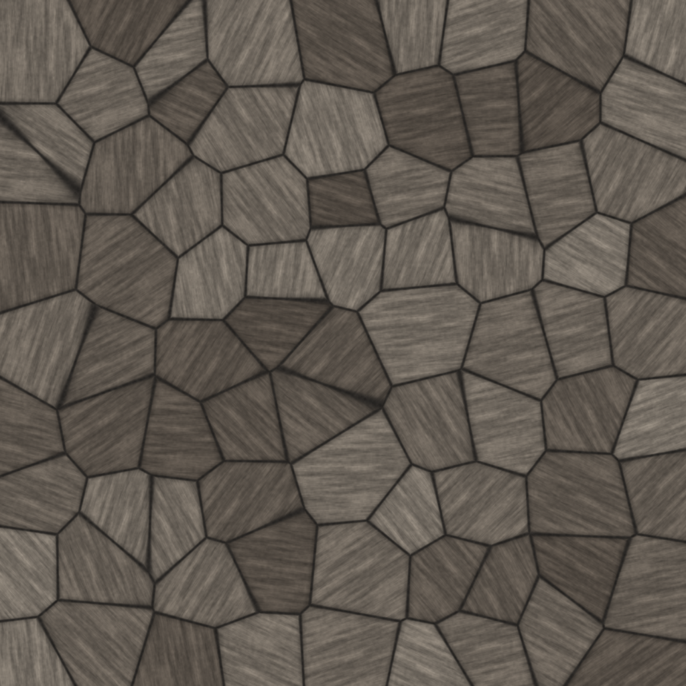
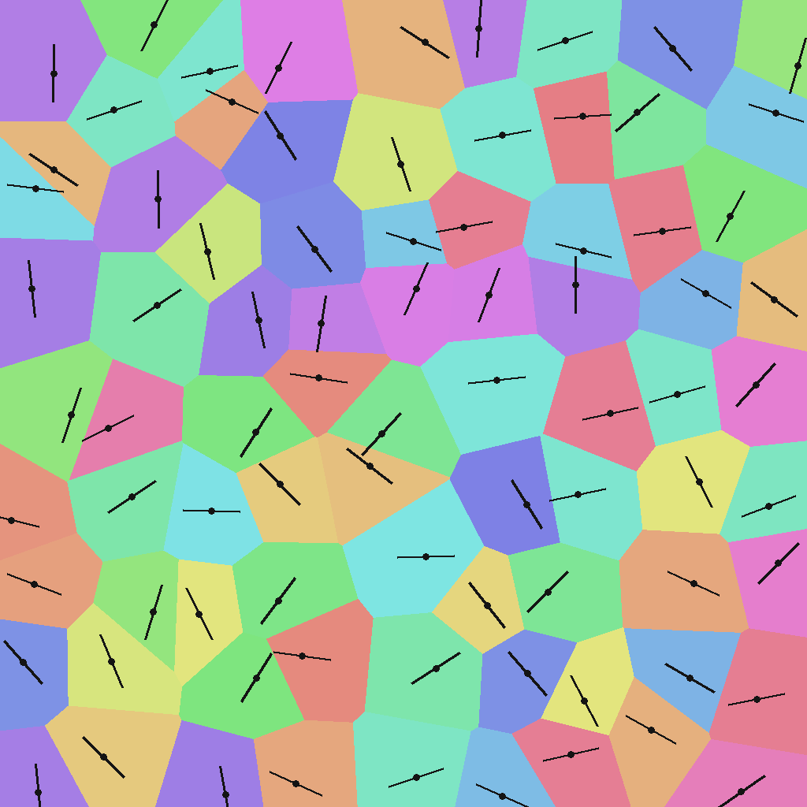

# Stone Wall Alignment — Development, Part 1

*Per-cell UV alignment in Houdini COPs, after Ben Wilson's "Alignment Node" series.*

A procedural stone wall where **every stone gets its own grain direction**: Voronoi cells → per-cell random frame → detail UVs rotated per cell → stretched noise sampled in the cell frame = directional grain per stone.



> Status: the shader (`stone_wall_align.vfl`) and the math prototype are done and
> the renders above are visual targets from the prototype. Houdini COPs captures
> replace them once the network is run — the math is identical per pixel.

## The idea

Ben Wilson's "Alignment Node" series builds a Substance Designer node that *measures* every shape in a texture — flood fill to find farthest pixels, corner points, basis vectors — and aligns UVs to each shape's own frame ([Part 4](https://www.artstation.com/blogs/benwilson/nZ67/alignment-node-development-part-4)). This project rebuilds the same idea in Houdini's pixel processor: COPs.

A full flood fill in a pixel shader is a project by itself. So Part 1 starts where the shapes are free: **Voronoi cells**. Every pixel analytically knows its cell, which means the entire alignment pipeline — per-shape frames, warped detail UVs, the lot — can be built today. The flood fill gets earned in Part 2.

## The data

One `voronoise()` call per pixel returns three things: **F1** (distance to the nearest feature point), **F2** (distance to the second-nearest), and the **feature point position**. The cell id comes from hashing the feature-point position — no integer labels needed, the float position is unique per cell.



*The overlay: every cell colored by id, with its alignment frame drawn as a tick through the feature point. The direct analog of Ben's "alignment points overlaid on the stone wall" figure — the "does the math do what I think" view. In the shader it's `debug=1`.*

## Parameters

| Parm | Default | What it does |
|---|---|---|
| cells | 9 | stones across the tile |
| jitter | 0.8 | how irregular the cells are (0 = grid, 1 = fully random) |
| mortar | 0.055 | mortar width, as a fraction of cell size |
| detail | 26 | grain pattern frequency |
| stretch | 7 | grain elongation along the cell frame |
| grain | 0.45 | grain contrast |
| seed | 7 | layout variation |
| debug | 0 | 1 = cell/frame overlay instead of shading |

## Theory in two facts

- **F2 − F1 ≈ 0 exactly on cell borders.** Where the two nearest feature points are equidistant, you're on an edge. The standard Voronoi edge trick — mortar lines plus an edge-AO falloff for free.
- **A per-cell frame is just a 2D rotation.** Translate the pixel into the cell's local space (subtract the feature point), rotate by the cell's angle, scale up. Whatever you sample in that warped space — noise, a pattern, a texture — now follows the cell's orientation.

## Construction

```
rel   = uv − cell_center          # into cell-local space
q     = R(−angle) · rel · detail  # rotate into the cell frame, scale up
grain = stretched_noise(q)        # elongated along the frame's x-axis
```

The stretch is what makes it read as *grain* instead of blotches: noise stretched 7× along one axis of the rotated frame looks like stone sediment following the stone's direction. Without the rotation every stone would share one global grain direction and the trick would be visible instantly.

## Implementation

Five steps, matching the code sections in `stone_wall_align.vfl`:

1. **Voronoi** — `voronoise()` gives F1, F2, and the feature-point position per pixel.
2. **Cell id** — `hash(feature_point + seed)`. Float position in, stable 0–1 random out. No labels, no buffers.
3. **Mortar + AO** — `smoothstep` on (F2−F1) for mortar; a wider falloff of the same value, square-rooted, fakes the bevel AO.
4. **Warp + grain** — rotate into the per-cell frame, sample stretched `fbm`. Plus a high-frequency `fbm` "tooth" so close-ups don't go plasticky.
5. **Shade + debug** — per-cell albedo variation, mortar color, and the `debug` overlay (HSV cell colors, orientation ticks drawn as distance-to-segment in the shader itself).

**Gotchas:** VEX `voronoise`'s jitter is 0–1, not a pixel radius — and the feature-point position comes back in *scaled* space, so divide by `cells` to get back to UV before using it as a rotation pivot. Second: hashing the float feature-point position is stable per cell *because* the point doesn't move — which is exactly what makes integer cell ids unnecessary.

## Result

Every stone has its own grain direction, its own tone, mortar between them, AO in the joints.

## Limitations (the honest section)

**The frames are random per cell, not measured from the shape.** That's the opposite of Ben's approach — he measures, I roll dice. It looks right only because Voronoi cells are convex-ish; on real stone photos the frames would be wrong.

The fix is Ben's own suggestion from his Part 4: **image moments** — the second-order moment gives the axis of minimum energy per connected component, a real measured frame. But that needs connected-component labeling in COPs first, which is the actual hard part. That's Part 2.

## Files

- `stone_wall_align.vfl` — the COPs shader. Paste into a VEX Wrangle (see below).
- `stone_wall_align.py` — Python prototype of the same math; also the source of the preview images.

## Run it in Houdini

1. `/img` network → VEX Wrangle. On the Wrangle: Parameters tab → Planes → add vector3 plane `Cd`.
2. Set resolution 1024×1024. Paste `stone_wall_align.vfl` into the VEX Snippet.
3. Set parms: cells=9, jitter=0.8, mortar=0.055, detail=26, stretch=7, grain=0.45, seed=7, debug=0.
4. Flip `debug` to 1 for the overlay figure. Write to disk with a File COP below it.

The baked texture drops straight onto a wall in Solaris — procedural in COPs, consumed in USD.

## Credit

The entire concept is downstream of Ben Wilson's alignment-node series — read his [Part 4](https://www.artstation.com/blogs/benwilson/nZ67/alignment-node-development-part-4) first. This repo is the Houdini footnote to his Substance original.
